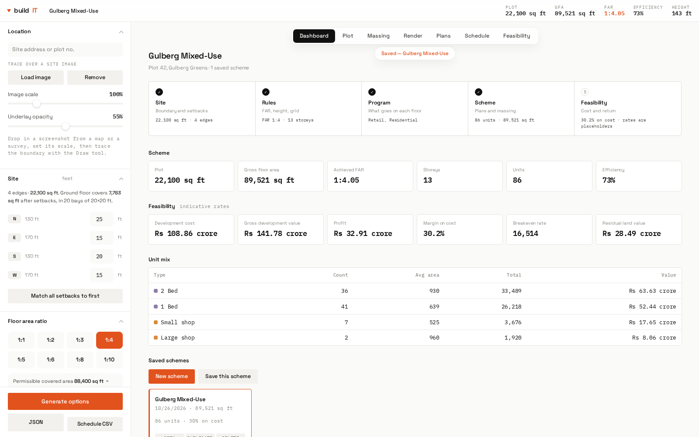
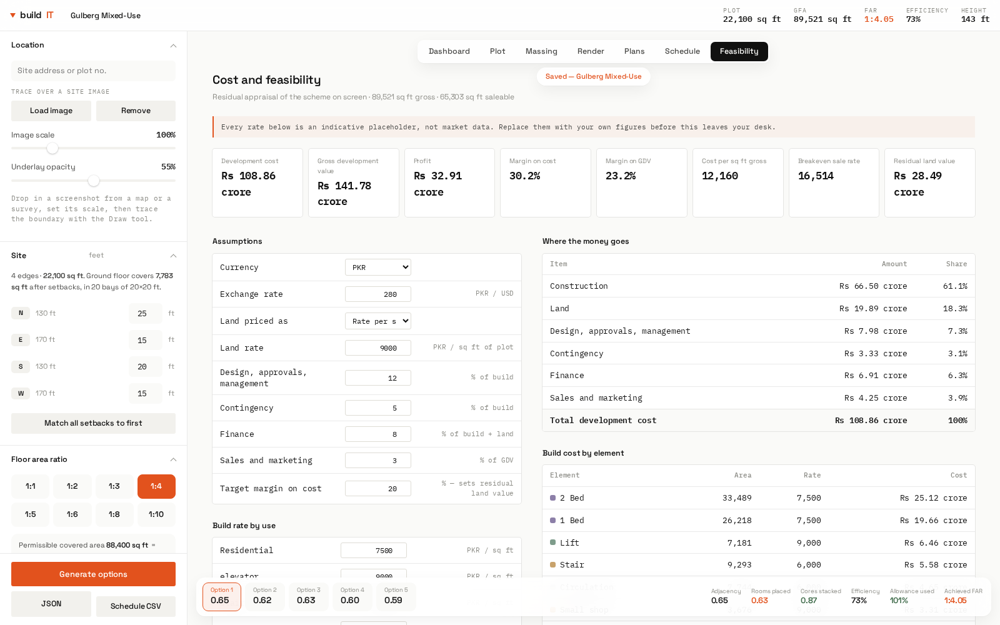
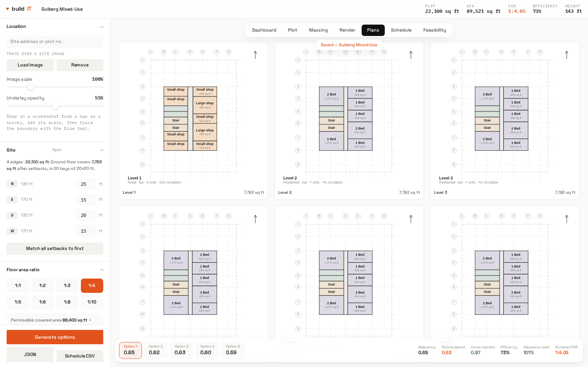

# buildIT

A building generator and proposal configurator for commercial and mixed-use schemes —
a browser-based parametric massing and floor-plan tool for early-stage architectural
feasibility. Draw a site in feet, set the bye-law setbacks edge by edge, pick an FAR
ratio, and it solves a buildable envelope — then gives you storey plans, a structural
frame, a rendered 3D view and an area schedule. Single HTML file, no build step, no
server, no account. Open it and it runs.

## What it does

**Site.** Draw the boundary on a canvas in feet, or trace it over a screenshot of a
map or survey (load the image, set its scale, trace on top). Click any dimension to
type an exact measurement. Setbacks are per edge, so a four-sided plot takes four
different values and an irregular plot takes as many as it has edges.

**Envelope.** Pick an FAR ratio (1:1 through 1:10) and the permissible covered area
follows from the plot area. The solver fills that allowance with whole storeys plus
one trimmed top storey, respects a height limit and floor-to-floor, and lays the
structural grid at whatever building angle you set — the grid turns with the
building, not with the screen.

Setbacks are enforced per bay, not per centroid: all four corners of a bay must clear
the setback line before it is considered buildable, so slabs never overhang.

**Program.** Ten use types (apartment, studio, office, co-working, retail, food &
drink, amenity, services, parking, circulation). Assign uses floor by floor; the
solver distributes them across each plate, keeps lift shafts pinned to the same grid
position on every storey, and guarantees that every unit touches circulation.

**Dashboard.** Every scheme opens on a project overview: a five-step workflow
strip showing what is done and what is next, the headline areas, the appraisal
summary and the unit mix. Schemes are saved in the browser and can be reopened,
duplicated or deleted. A saved project holds the *inputs* only — site, rules,
program and appraisal assumptions — so it stays small and is re-solved on open
rather than going stale against a newer solver.

**Cost and feasibility.** A residual appraisal built from the area schedule, so
it always describes the scheme on screen. Build cost per element, land, design
and approvals, contingency, finance and marketing stack up into a development
cost; the saleable area is valued unit by unit into a GDV. It reports profit,
margin on cost and on GDV, cost per sq ft, and the two numbers that actually
decide a deal — the **breakeven sale rate** and the **residual land value**,
which is the most you could pay for the site and still hit your target margin.
Every rate is editable in place, and switchable between PKR and USD.

**Output.** Massing view, rendered view with facade styles and materials, storey
plans drawn as architectural plans (poché walls, door swings, glazing, stair treads,
grid bubbles), an editable plan view, and an area schedule exportable as JSON or CSV.

| | |
|---|---|
|  |  |
| Residual appraisal, rates editable in place | Storey plans with grid and annotation |

## Running it

Download `index.html` and open it in a browser. That's the whole install.

It pulls Three.js from a CDN for the 3D views. If that fails, or if WebGL is off, the
3D pane says so and everything else — plot, plans, schedule, export — still works.

## How the solver works

The approach is adapted from the voxel-graph / program-graph idea in
[Building-GAN](https://arxiv.org/abs/2104.13316) (Chang et al., ICCV 2021), but with
the learned generator replaced by a deterministic rule-based solver. No model, no
training, no GPU — it runs in a few hundred milliseconds in a tab.

1. **Voxel graph.** The plot is cut into structural bays. A bay survives if all four
   corners clear every edge setback. Surviving bays are stacked into storeys.
2. **Program graph.** The use mix becomes a set of rooms with target areas and
   adjacency preferences — the bubble diagram, built from your inputs.
3. **Seeded region growing.** Each room gets a seed bay and grows outward. Growth is
   contiguous by construction, so a room can never end up in two disconnected pieces.
4. **Simulated annealing** over seed positions, scored on adjacency, compactness,
   daylight for leasable space, core stacking and FAR fit.
5. **Access by construction.** The corridor is laid first and every unit is cut
   against it, so access is a property of the layout rather than something
   checked afterwards.

Units themselves are not planned on the bay grid. A 22 ft bay is 484 sq ft, so a
620 sq ft apartment cannot be built from a whole number of them. Instead the
planner strikes a corridor through the plate and cuts the leftover depth into
units **by frontage**, which is continuous — the same thing an architect does
when tuning unit widths to a structural bay. It picks between three typologies
by building each one the plate can carry and scoring them against each other:

| typology | when it is used |
|---|---|
| **courtyard** | perimeter units, corridor ring, daylit void in the middle |
| **bar** | double-loaded corridor, units both sides, all with daylight |
| **single** | one band against a corridor, for a narrow plate |

Verified across an 840-case sweep over plate sizes and both uses: every unit
reachable from circulation, no overlapping rooms, every floor 100% filled,
circulation never above 21%. Unit-area error median 2.7%, 90th percentile 11%.

## Known limitations

Worth reading before trusting the output.

**Every cost and sale rate is an indicative placeholder.** They are starting
points chosen to be plausible, not market data, and they have not been checked
against current tender prices or comparables. Replace them with your own figures
before an appraisal from this leaves your desk. The method is sound; the inputs
are yours to supply.

**Saved schemes live in one browser.** Projects are kept in that browser's local
storage — they do not sync between machines, and clearing site data deletes
them. Where storage is blocked entirely the app says so and keeps projects for
the session only.

**The wall-editing tools are inert.** They act on bay edges, which the plans no
longer use, so the zoomed plan is read-only until they are rebuilt against
units. Everything else in that view works.

**Unit areas still drift a little.** Median error is 2.7% and the 90th
percentile 11%, but a short leftover run beside the core can produce an
oddly-sized unit — the worst in the sweep was 36% out. The planner fills the
floor rather than leaving a hole, which is the right trade but does occasionally
make a unit it would not have chosen.

**A courtyard costs floor area.** On a deep plate the light well is a void, so
the building will not reach its full FAR allowance. That is a real consequence
of the typology, not a bug, but it means the achieved FAR can sit below the
ratio you asked for.

**Facade styles are incomplete.** Modern, neoclassical, art deco and others are
in. Zaha Hadid and Norman Foster styles were requested and never built.

**No structural engineering.** Columns, beams and slabs are drawn to look right
and to make the massing read as a building. Sizes are not calculated and carry
no engineering meaning.

**Bye-laws are setbacks and FAR only.** No fire egress distances, no parking
ratios, no daylight-angle rules, no height-plane restrictions beyond the flat
limit.

## Project status

Working internal tool, actively rough in the places listed above. It is a feasibility
and option-generation aid for the sketch stage — not a documentation tool and not a
substitute for Revit or ArchiCAD.

## Credits

Solver concept adapted from Building-GAN (Chang, Cheng, Luo, Chaudhuri, Fisher,
Bernstein, Tang, Yumer — ICCV 2021). 3D via [Three.js](https://threejs.org/).
Everything else is plain HTML, CSS and JavaScript with no framework.
