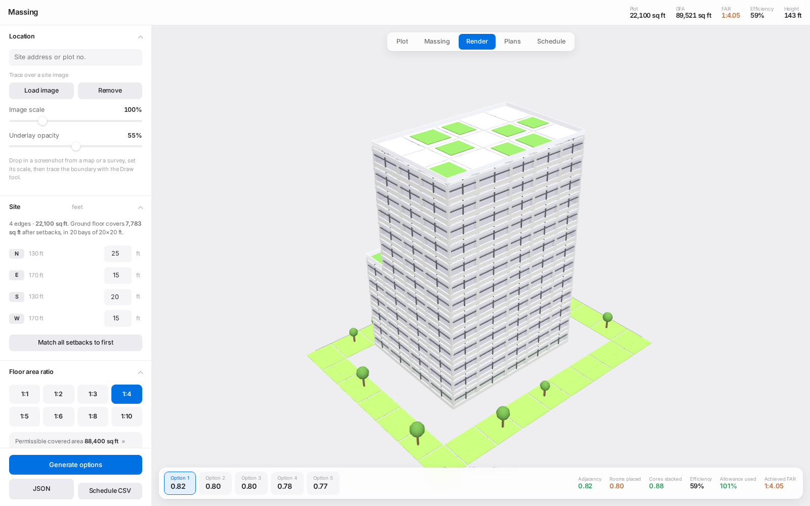
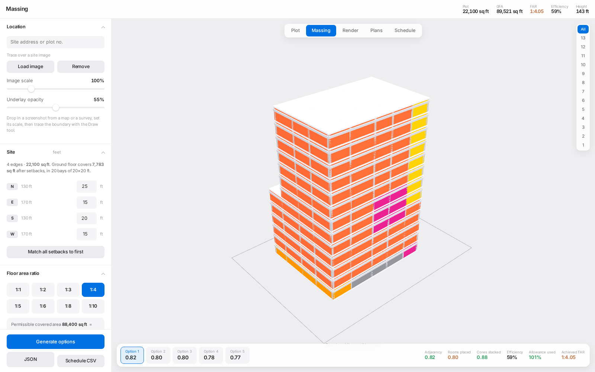

# Buildit

A building generator and proposal configurator for commercial and mixed-use schemes —
a browser-based parametric massing and floor-plan tool for early-stage architectural
feasibility. Draw a site in feet, set the bye-law setbacks edge by edge, pick an FAR
ratio, and it solves a buildable envelope — then gives you storey plans, a structural
frame, a rendered 3D view and an area schedule. Single HTML file, no build step, no
server, no account. Open it and it runs.

## What it does

**Site.** Draw the boundary on a canvas in feet, or trace it over a screenshot of a
map or survey (load the image, set its scale, trace on top). Click any dimension to
type an exact measurement. Setbacks are per edge, so a four-sided plot takes four
different values and an irregular plot takes as many as it has edges.

**Envelope.** Pick an FAR ratio (1:1 through 1:10) and the permissible covered area
follows from the plot area. The solver fills that allowance with whole storeys plus
one trimmed top storey, respects a height limit and floor-to-floor, and lays the
structural grid at whatever building angle you set — the grid turns with the
building, not with the screen.

Setbacks are enforced per bay, not per centroid: all four corners of a bay must clear
the setback line before it is considered buildable, so slabs never overhang.

**Program.** Ten use types (apartment, studio, office, co-working, retail, food &
drink, amenity, services, parking, circulation). Assign uses floor by floor; the
solver distributes them across each plate, keeps lift shafts pinned to the same grid
position on every storey, and guarantees that every unit touches circulation.

**Output.** Massing view, rendered view with facade styles and materials, storey
plans drawn as architectural plans (poché walls, door swings, glazing, stair treads,
grid bubbles), an editable plan view, and an area schedule exportable as JSON or CSV.

| | |
|---|---|
|  |  |
| Massing — colour-coded by use | Storey plans with grid and annotation |

## Running it

Download `index.html` and open it in a browser. That's the whole install.

It pulls Three.js from a CDN for the 3D views. If that fails, or if WebGL is off, the
3D pane says so and everything else — plot, plans, schedule, export — still works.

## How the solver works

The approach is adapted from the voxel-graph / program-graph idea in
[Building-GAN](https://arxiv.org/abs/2104.13316) (Chang et al., ICCV 2021), but with
the learned generator replaced by a deterministic rule-based solver. No model, no
training, no GPU — it runs in a few hundred milliseconds in a tab.

1. **Voxel graph.** The plot is cut into structural bays. A bay survives if all four
   corners clear every edge setback. Surviving bays are stacked into storeys.
2. **Program graph.** The use mix becomes a set of rooms with target areas and
   adjacency preferences — the bubble diagram, built from your inputs.
3. **Seeded region growing.** Each room gets a seed bay and grows outward. Growth is
   contiguous by construction, so a room can never end up in two disconnected pieces.
4. **Simulated annealing** over seed positions, scored on adjacency, compactness,
   daylight for leasable space, core stacking and FAR fit.
5. **Access by construction.** The corridor spine is laid first and every room is
   rooted on a bay with corridor frontage, so access is a property of the layout
   rather than something checked afterwards.

Verified across a 120-case sweep: 100% unit access, zero fragmented rooms, zero FAR
breaches, circulation held under 21% of plate area.

## Known limitations

Worth reading before trusting the output.

**Unit areas drift from the brief.** This is the significant one. Rooms are assembled
from whole structural bays, so a 22 ft bay is 484 sq ft and a 620 sq ft apartment
cannot be expressed exactly. Median unit-area error is around 56%. The layouts are
contiguous, accessible and code-compliant on setbacks and FAR — but they are massing
studies and bay-level block plans, not unit plans you can dimension from.

The fix is to model the corridor as a strip running through bays rather than as whole
bays, which frees the leftover depth for rooms. That is a rebuild of the solver core,
not a patch. Four lighter attempts (planning-grid subdivision, gradient rebalancing,
claim-back growth, and a comb/teeth double-loaded-corridor layout) were tried and
reverted — the best of them improved unit areas but fragmented 31 of 120 plates.

**Small pockets are dropped.** About 0.71% of floor area ends up in pockets that
can't be reached without passing through a corridor or lift shaft, and is discarded.

**Facade styles are incomplete.** Modern, neoclassical, art deco and others are in.
Zaha Hadid and Norman Foster styles were requested and never built.

**No structural engineering.** Columns, beams and slabs are drawn to look right and
to make the massing read as a building. Sizes are not calculated and carry no
engineering meaning.

**Bye-laws are setbacks and FAR only.** No fire egress distances, no parking ratios,
no daylight-angle rules, no height-plane restrictions beyond the flat limit.

## Project status

Working internal tool, actively rough in the places listed above. It is a feasibility
and option-generation aid for the sketch stage — not a documentation tool and not a
substitute for Revit or ArchiCAD.

## Credits

Solver concept adapted from Building-GAN (Chang, Cheng, Luo, Chaudhuri, Fisher,
Bernstein, Tang, Yumer — ICCV 2021). 3D via [Three.js](https://threejs.org/).
Everything else is plain HTML, CSS and JavaScript with no framework.
